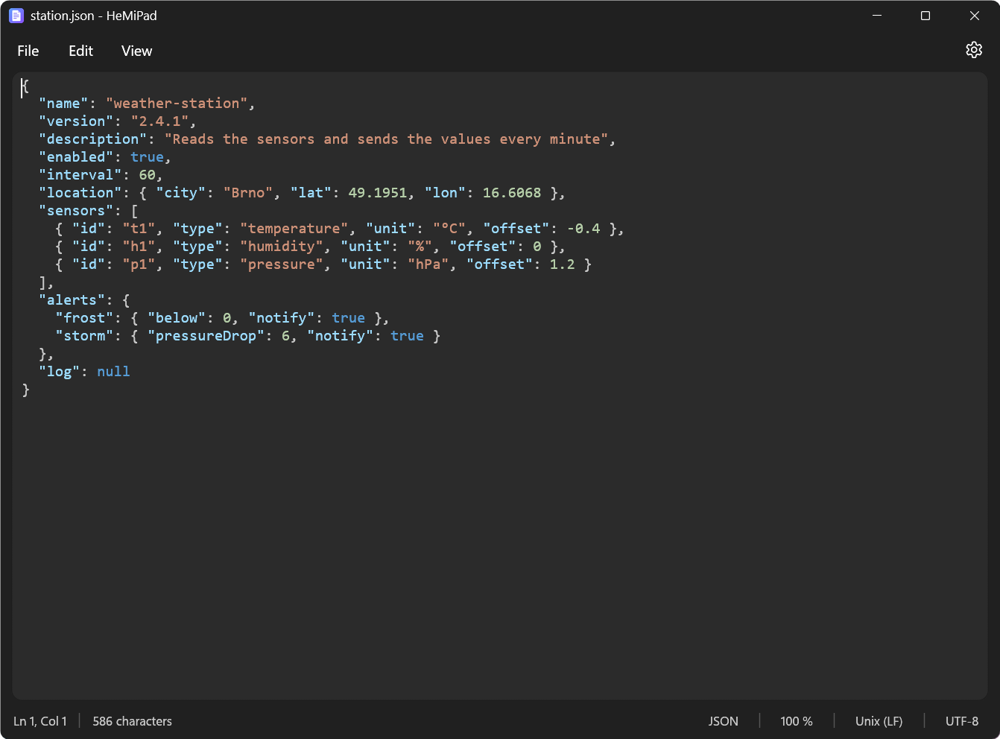

# HeMiPad

[](https://github.com/Hemal1k/HeMiPad/releases/latest) [](https://github.com/Hemal1k/HeMiPad/releases) [](LICENSE) 

Everything of the classic Notepad – in the look of Windows 11, with **dark mode**, **colours for JSON and YAML**, line numbers and
**spell check**. Small, fast and without any internet features. English and Czech.

**[Download](https://github.com/Hemal1k/HeMiPad/releases/latest)** · [Project page](https://hemal1k.github.io/hemipad.html) · [Report a problem](https://github.com/Hemal1k/HeMiPad/issues)



> Not signed yet – Windows SmartScreen may warn the first time (More info → Run anyway).

## Download

| File | For |
|---|---|
| `HeMiPad-Setup.exe` | The installer – just for you (no administrator) or for all users (Program Files), with a Start menu entry and an uninstaller. |
| `HeMiPad-Portable.zip` | Just the program; run it from any folder. |

Windows 10 / 11, x64. Nothing else needs to be installed.

## Features

- **File**: new, new window, open, save, save as, print and page setup; drag and drop, files from the command line; unsaved
  changes are asked about.
- **Edit**: undo / redo, find (F3 / Shift+F3), replace, go to line, select all, time and date (F5).
- **View**: zoom (Ctrl+wheel), word wrap, status bar, line numbers, colours, spell check.
- **Colours** for JSON, YAML, XML, INI / TOML and Markdown; Enter keeps the indentation, Tab / Shift+Tab on several lines.
- **Spell check** with the dictionaries of Windows (Czech and English together, suggestions on right click).
- **Encodings**: UTF-8 with or without BOM, UTF-16 LE / BE, ANSI, OEM; line endings CRLF / LF / CR – in the status bar.
- **.LOG** files get the time and date at their end, a file changed by another program is offered to reload.
- **Settings**: theme (automatic / light / dark), language, and the optional File Explorer item “Open in HeMiPad”.

HeMiPad never connects to the internet. Its settings are in `%AppData%\HeMiPad\settings.ini`.

## Building

Needs [Rust](https://rustup.rs) (stable, MSVC target) on Windows.

```
cargo build --release
```

The exe is `build\release\HeMiPad.exe` (`.cargo\config.toml` sets the build folder and puts the C runtime inside the exe, so it
runs without the Visual C++ Redistributable).

`release.ps1` builds the downloads into `build\dist` (needs [Inno Setup 6](https://jrsoftware.org/isinfo.php)): the installer
(`installer\HeMiPad.iss`) and the portable zip. A release published on GitHub runs the same script in
`.github\workflows\release.yml` and gets the files attached.

## Project

| File | Contents |
|---|---|
| `src\main.rs` | Start: the window, the file from the command line. |
| `src\app.rs` | The window: menu bar, find bar, editor, status bar and dialogs. |
| `src\doc.rs` | Reading and writing text files with their encoding and line endings. |
| `src\syntax.rs` | Colouring of JSON, YAML, XML, INI / TOML and Markdown. |
| `src\spell.rs` | Spelling with the Spell Checking API of Windows. |
| `src\print.rs` | Page setup and printing (the dialogs of Windows, GDI). |
| `src\settings.rs` | What HeMiPad remembers between runs. |
| `src\shell_menu.rs` | The optional File Explorer item (`HKCU\Software\Classes`). |
| `src\sys.rs` | Small Windows helpers: a new window, the time and date of F5, the font of the editor. |
| `src\theme.rs`, `src\widgets.rs`, `src\i18n.rs` | The Windows 11 look in egui and the English / Czech texts. |
| `assets` | The icon and the notices of the components. |

## License

[MIT](LICENSE).
